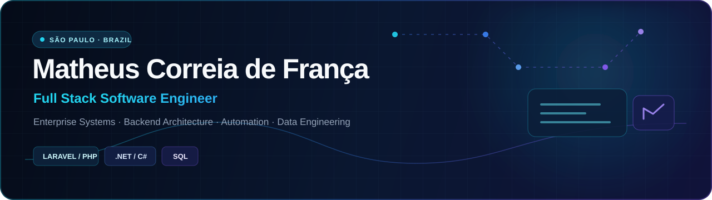
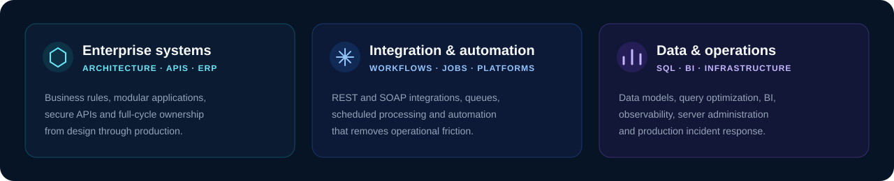
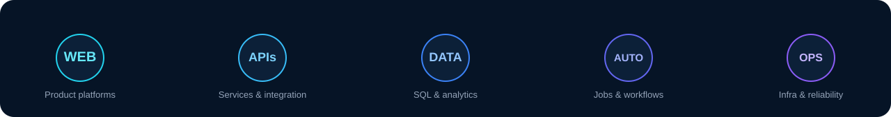

<picture>
  <source media="(prefers-color-scheme: dark)" srcset="./assets/hero-dark.svg">
  <source media="(prefers-color-scheme: light)" srcset="./assets/hero-light.svg">
  
</picture>

## Engineering software across the full lifecycle

I am a **Full Stack Software Engineer** who builds and sustains enterprise applications, APIs, integrations, automation and data workflows. My experience reaches beyond feature delivery: I work across business rules, database design, infrastructure, production support, observability and the continuous evolution of systems used in daily operations.

My strongest work sits at the intersection of **Laravel and PHP**, **C# and .NET**, **SQL**, system integration and operational automation. I enjoy turning complex, manual processes into reliable software with clear architecture, measurable behavior and maintainable code.

> **What I bring:** end-to-end ownership, backend depth, practical infrastructure experience and the ability to translate business operations into dependable systems.

<strong>Resumo em português</strong>

 
Sou Engenheiro de Software Full Stack com atuação no desenvolvimento e sustentação de sistemas corporativos, APIs, integrações, automações e fluxos de dados. Trabalho em todo o ciclo de engenharia: regras de negócio, modelagem e otimização SQL, frontend, infraestrutura, observabilidade e suporte à produção. Minha experiência principal está em Laravel/PHP, C#/.NET, SQL e automação de processos.

## Core engineering domains

### Primary stack

**Backend & application engineering**

**Frontend & product interfaces**

**Databases, data & infrastructure**

Complementary experience includes Bootstrap, Active Directory, VPNs, server automation, queues, monitoring, PHPUnit/Pest, Laravel Dusk and Larastan.

## Engineering highlights

| Area | What I have delivered |
|:--|:--|
| **Enterprise systems** | Architecture, business rules and evolving modules for a corporate ERP used across multiple operational areas. |
| **Integration & automation** | REST/SOAP integrations, scheduled jobs and workflows that connect platforms and reduce manual operational work. |
| **Data engineering & BI** | SQL optimization, stored procedures, ETL-style processing, data models, dashboards and executive indicators. |
| **Production operations** | Deployment, server and network administration, incident investigation, observability and application support. |
| **Quality & evolution** | Automated tests, static analysis, security-minded design and incremental modernization of long-lived systems. |

### Private enterprise case study

My main professional system is proprietary, so its source code and operational details are not public. In generic terms, I have individually owned substantial parts of an ERP's architecture, domain logic, integrations, dashboards, automation and infrastructure. The work requires balancing product delivery with data integrity, backward compatibility, production reliability and support for different business functions.

No client names, internal endpoints, operational data or confidential metrics are disclosed here.

## Featured engineering work

<table>
<tr>
<td width="50%" valign="top">

### [PulseOps AI](https://github.com/matheuscorreiafranca/PulseOps-AI)

Operational intelligence copilot with controlled tool calling, RAG, cited evidence, Structured Outputs, real SSE streaming and human approval before remediation.

`React` `TypeScript` `Fastify` `PostgreSQL` `pgvector` `Redis` `BullMQ` `LLM`

</td>
<td width="50%" valign="top">

### [VoluntaMais](https://github.com/matheuscorreiafranca/TCC-Voluntariado)

Full Stack platform for volunteer opportunities, applications and institutions, with a .NET API, Next.js interface and production-oriented Docker topology.

`ASP.NET Core` `Next.js` `TypeScript` `MySQL` `EF Core` `Docker` `Nginx`

</td>
</tr>
<tr>
<td width="50%" valign="top">

### [Radar Econômico Brasil](https://github.com/matheuscorreiafranca/radar-economico-brasil)

Economic intelligence platform that consolidates official Brazilian indicators into a typed application with analytics, data ingestion and operational tooling.

`TypeScript` `Data Engineering` `Analytics` `Docker` `REST API`

</td>
<td width="50%" valign="top">

### [BookShelf](https://github.com/matheuscorreiafranca/CBTSWE2_TP04)

Documented ASP.NET Core CRUD application with an independent domain DLL, EF Core migrations, SQLite, Swagger, responsive UI and integration tests.

`C#` `.NET 8` `ASP.NET Core` `EF Core` `SQLite` `xUnit`

</td>
</tr>
<tr>
<td width="50%" valign="top">

### [ProntoPerto](https://github.com/matheuscorreiafranca/ProntoPerto)

Mobile experience built with .NET MAUI, focused on product interaction, clean visual presentation and cross-platform delivery.

`C#` `.NET MAUI` `Mobile` `Python`

</td>
<td width="50%" valign="top">

### [Distribution Management](https://github.com/matheuscorreiafranca/sistema-distribuicao-produtos)

Laravel application for inventory, requests, distribution workflows, approvals and reporting across organizational units.

`PHP 8.2` `Laravel 12` `Blade` `Redis` `Pest` `Vite`

</td>
</tr>
</table>

## Public engineering footprint

The repositories above are selected evidence, not a proficiency ranking. Much of my production engineering work lives in private enterprise systems. Explore the [complete public repository catalog](https://github.com/matheuscorreiafranca?tab=repositories) or my [GitHub contribution activity](https://github.com/matheuscorreiafranca?tab=overview&from=2026-01-01&to=2026-12-31).

## Professional journey

- **Current — Enterprise software engineering:** full-cycle development and support of corporate systems, integrations, automation, data flows and infrastructure.
- **Ongoing — Portfolio engineering:** production-shaped projects across TypeScript, .NET, PHP/Laravel, data products and mobile applications.
- **Expected 2026 — Technology degree:** Analysis and Systems Development at the Federal Institute of São Paulo, Cubatão campus.

## Global communication

| Language | Proficiency |
|:--|:--|
| Portuguese | Native |
| English | C1 — Advanced professional proficiency |
| French | B2 — Upper-intermediate proficiency |

## Let's build reliable software

I am open to conversations about **Full Stack Engineering, Backend Development, Enterprise Systems, Laravel, .NET, SQL, automation and data-intensive applications** in Brazil or international environments.

### [Start a conversation →](mailto:matheuscorreiadefranca@gmail.com)

São Paulo, Brazil · Available in Portuguese, English and French

